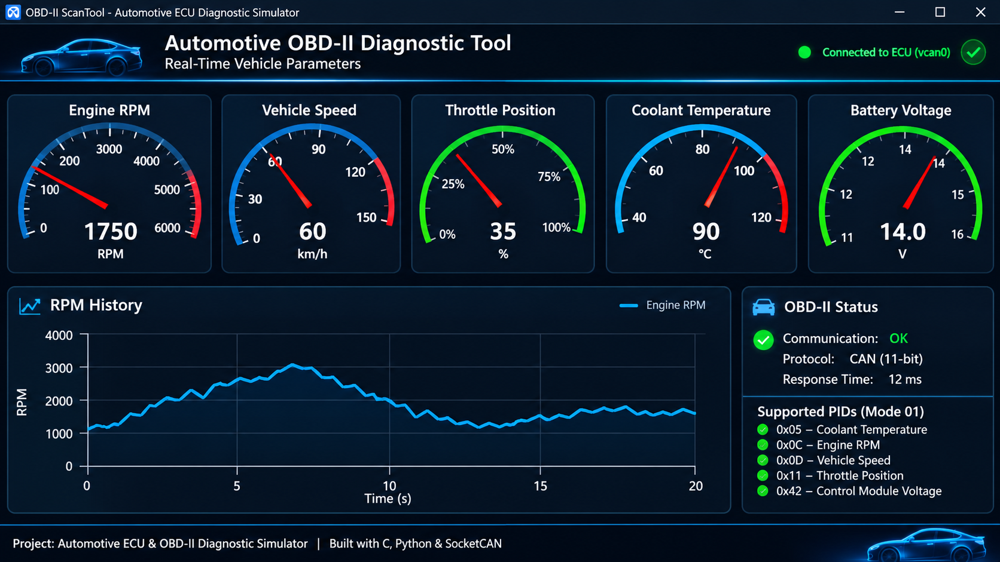

<p align="center">
# Automotive ECU & OBD-II Diagnostic Simulator

**A Virtual Automotive Engine Control Unit (ECU) and Real-Time OBD-II Diagnostic Tool**

Built with C, Python, SocketCAN, and Linux.

</p>
---

## Dashboard Preview



---

## Overview

This project implements a virtual automotive diagnostic environment composed of two independent software components:

- **ECU Simulator (C):** Simulates an automotive engine control unit, models engine parameters, communicates through a virtual CAN bus, and processes OBD-II diagnostic requests.
- **OBD-II ScanTool (Python):** Communicates with the virtual ECU, sends diagnostic requests, decodes responses, and displays vehicle parameters through a real-time graphical dashboard.

The project demonstrates the fundamentals of automotive embedded systems, CAN communication, ECU software architecture, and vehicle diagnostics.

**The system currently runs in a virtual CAN environment using SocketCAN and `vcan0`. It does not require a physical ECU or vehicle.**

## System Architecture

```text
                 AUTOMOTIVE DIAGNOSTIC SYSTEM

+-------------------------------------------+
|           Python OBD-II ScanTool          |
|                                           |
|  +-------------+    +------------------+  |
|  | CAN Client  | -> | OBD-II Services  |  |
|  +-------------+    +------------------+  |
|                             |             |
|  +-------------+    +------------------+  |
|  |   Decoder   | <- | CAN Communication|  |
|  +-------------+    +------------------+  |
|         |                                 |
|  +-------------------------------------+  |
|  |       Real-Time Dashboard           |  |
|  +-------------------------------------+  |
+--------------------+----------------------+
                     |
                     | SocketCAN
                     |
              +------v------+
              |   vcan0     |
              | Virtual CAN |
              |    Bus      |
              +------+------+
                     |
                     | SocketCAN
                     |
+--------------------v----------------------+
|              C ECU Simulator              |
|                                           |
|  +-------------+    +------------------+  |
|  | CAN Interface| <-| OBD-II Processor |  |
|  +-------------+    +------------------+  |
|         |                    |            |
|         |             +------v-------+    |
|         +------------>| Engine Model |    |
|                       +--------------+    |
+-------------------------------------------+
```

## Main Features

### 1. Virtual ECU Simulator — C

The ECU simulator is developed in C and uses Linux SocketCAN for CAN communication.

Main functionalities:

- Virtual engine parameter simulation.
- CAN interface initialization and management.
- CAN frame reception and transmission.
- OBD-II request processing.
- OBD-II Mode 01 diagnostic responses.
- Engine parameter encoding into CAN response frames.

### 2. Python OBD-II ScanTool

The ScanTool is developed in Python and communicates with the ECU through SocketCAN.

Main functionalities:

- CAN bus connection and management.
- OBD-II Mode 01 request generation.
- CAN response reception.
- OBD-II response validation and decoding.
- Real-time diagnostic data visualization.
- Graphical dashboard using Tkinter.

### 3. Real-Time Diagnostic Dashboard

The graphical interface provides visual monitoring of simulated vehicle parameters.

Dashboard features:

- Engine RPM gauge.
- Vehicle speed gauge.
- Throttle position gauge.
- Engine coolant temperature.
- Battery/control module voltage.
- RPM history graph.
- Connection status indicator.
- Smooth gauge animations and RPM red-zone indication.

## Supported OBD-II Parameters

The simulator currently supports the following standard OBD-II Mode 01 PIDs:

| PID | Parameter | Unit | Description |
|---|---|---|---|
| `0x05` | Coolant Temperature | °C | Engine coolant temperature |
| `0x0C` | Engine RPM | rpm | Engine rotational speed |
| `0x0D` | Vehicle Speed | km/h | Vehicle speed |
| `0x11` | Throttle Position | % | Throttle opening position |
| `0x42` | Control Module Voltage | V | Control module supply voltage |

### OBD-II Communication Example

A diagnostic request for engine RPM:

```text
CAN ID: 0x7DF
DLC:    8
DATA:   02 01 0C 00 00 00 00 00
```

Example ECU response:

```text
CAN ID: 0x7E8
DLC:    8
DATA:   04 41 0C 1A F8 00 00 00
```

The decoded RPM value is calculated using the standard OBD-II formula:

```text
RPM = (256 × A + B) / 4
```

For this example:

```text
RPM = (256 × 0x1A + 0xF8) / 4
RPM = 1726 rpm
```

## Project Structure

```text
automotive_project/
│
├── ecu_simulator/
│   ├── include/
│   │   ├── Can_interface.h
│   │   ├── Engine_model.h
│   │   └── obd2.h
│   │
│   ├── src/
│   │   ├── can_interface.c
│   │   ├── engine_model.c
│   │   └── obd2.c
│   │
│   ├── tests/
│   ├── main.c
│   └── Makefile
│
├── scantool/
│   ├── communication/
│   │   └── can_client.py
│   │
│   ├── config/
│   │   └── settings.py
│   │
│   ├── decoding/
│   │   └── decoder.py
│   │
│   ├── interface/
│   │   └── dashboard.py
│   │
│   ├── obd/
│   │   └── obd_services.py
│   │
│   ├── tests/
│   ├── main.py
│   ├── test_dashboard.py
│   └── requirements.txt
│
├── .gitignore
└── README.md
```

## Technologies & Tools

| Technology | Purpose |
|---|---|
| C | ECU simulator development |
| Python | Diagnostic application |
| SocketCAN | Linux CAN communication framework |
| Virtual CAN (`vcan0`) | CAN bus simulation |
| CAN Bus | Automotive communication |
| OBD-II | Vehicle diagnostic protocol |
| Tkinter | Graphical dashboard |
| python-can | Python CAN interface |
| Linux / Ubuntu | Development and execution environment |
| Git & GitHub | Version control and project hosting |

## Installation & Setup

### Requirements

- Ubuntu Linux 22.04 or compatible Linux distribution.
- GCC compiler.
- Make.
- Python 3.
- Python virtual environment support.
- SocketCAN.
- `python-can`.
- Tkinter.

Install the required system packages:

```bash
sudo apt update

sudo apt install build-essential gcc make \
python3 python3-pip python3-venv python3-tk \
can-utils
```

### 1. Configure the Virtual CAN Interface

Load the virtual CAN kernel module:

```bash
sudo modprobe vcan
```

Create the virtual CAN interface:

```bash
sudo ip link add dev vcan0 type vcan
```

Activate the interface:

```bash
sudo ip link set up vcan0
```

Verify the interface:

```bash
ip link show vcan0
```

### 2. Build the ECU Simulator

Navigate to the ECU simulator directory:

```bash
cd ecu_simulator
```

Compile the project:

```bash
make
```

### 3. Configure the Python ScanTool

Open another terminal:

```bash
cd scantool
```

Create a virtual environment:

```bash
python3 -m venv venv
```

Activate it:

```bash
source venv/bin/activate
```

Install Python dependencies:

```bash
pip install -r requirements.txt
```

## Running the Application

Start the system in the following order.

**Terminal 1 — ECU Simulator**

```bash
cd ~/automotive_project/ecu_simulator
./output/ecu_simulator
```

**Terminal 2 — Python ScanTool**

```bash
cd ~/automotive_project/scantool
source venv/bin/activate
python3 main.py
```

The ScanTool should connect to the virtual CAN interface, send OBD-II requests, receive ECU responses, decode diagnostic parameters, and display the results in the dashboard.

> Note: The executable path assumes that the Makefile generates `output/ecu_simulator`. If your Makefile uses a different output path, adjust the command accordingly.

## CAN Bus Monitoring

You can monitor CAN frames using `candump`:

```bash
candump vcan0
```

Example diagnostic traffic:

```text
vcan0  7DF  [8]  02 01 0C 00 00 00 00 00
vcan0  7E8  [8]  04 41 0C 1A F8 00 00 00
```

This allows you to observe the diagnostic request and the corresponding ECU response.

## Learning Objectives

This project explores several important automotive embedded systems concepts:

- ECU architecture and software organization.
- CAN bus communication.
- Linux SocketCAN programming.
- OBD-II diagnostic services and PIDs.
- CAN frame structure and data encoding.
- C systems programming.
- Python-based diagnostic applications.
- Real-time data visualization.
- Separation between communication, processing, decoding, and presentation layers.

## Future Improvements

Potential extensions include:

- ISO-TP implementation for multi-frame diagnostic communication.
- UDS (ISO 14229) diagnostic services.
- Diagnostic Trouble Codes (DTC) support.
- OBD-II freeze-frame data.
- Multiple virtual ECUs.
- CAN database integration using DBC files.
- CAN traffic logging and replay.
- Automated diagnostic testing.
- Hardware integration with a physical CAN transceiver.
- Integration with automotive validation and testing tools.

## Project Status

**Current implementation:** Virtual ECU simulation and OBD-II Mode 01 diagnostic communication over SocketCAN.

This is an ongoing educational and engineering project focused on automotive embedded systems and vehicle diagnostics.

## Author

**Otmane Chetoui**

Embedded Systems Student | Automotive Embedded Systems Enthusiast

**Technical Interests:**
- Automotive Embedded Systems
- ECU Development
- CAN Bus & OBD-II
- Embedded C / Python
- Automotive Diagnostics
- Embedded Software Testing

**GitHub:** [@otmanchetoui2007-cell](https://github.com/otmanchetoui2007-cell)

---

<p align="center">

**Automotive Embedded Systems • ECU Simulation • Vehicle Diagnostics**

</p>
